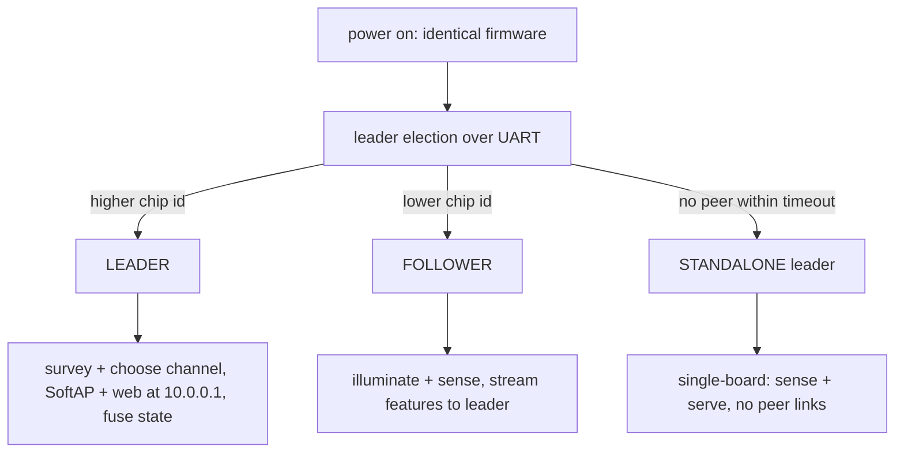
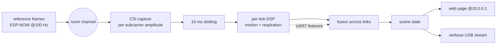

# Architecture

## 1. Purpose and scope

`xpol-csi` is a two-board **occupancy and respiration sensor** built from a pair of
identical Seeed XIAO ESP32-C5 modules. In a space the operator owns or has
consent to monitor, the device reports whether the room is occupied, a coarse
motion level, and — when someone is relatively still — an estimated respiration
rate per person.

It works by measuring the **channel state information (CSI)** of the device's own
reference transmissions: the fine-grained amplitude the radio recovers per
OFDM subcarrier. Moving bodies and the chest motion of breathing perturb that
channel; the firmware turns those perturbations into occupancy and respiration
estimates. No third-party traffic is decoded and no payload is inspected — only
the physical channel estimate of frames the node itself emits (and, where
present, the channel estimate of ambient frames on the same channel, used purely
as additional illumination of the same room).

The two boards are mounted back-to-back with opposite-hand circularly polarized
antennas so the direct path between them is suppressed and the body reflection
is a larger share of the received signal. The physics limits and the rationale
live in `README.md`.

### Non-goals and safety

- Not a life-safety device. "No detection" must never be surfaced as "the room
  is empty." It is an aid, not a guarantee.
- Not a people-counter or locator. Output is occupancy + motion level +
  respiration rate(s); it does not produce identities or positions.
- Intended for consented, operator-owned spaces (e.g. a room in your home, an
  elder-care presence aid, a search-and-rescue life-sign aid).

---

## 2. One firmware, two roles

Both boards flash the **same binary**. Roles are decided at runtime by a leader
election over the inter-board UART. This removes the node_a / node_b build split:
you build once, flash the same image to both, and the pair sorts itself out.



- **Leader** runs the channel survey, picks the quietest channel, tells the
  follower, hosts the SoftAP and the web page at `10.0.0.1`, and fuses both
  boards' per-link results into the scene.
- **Follower** emits reference frames (illumination), captures CSI, and streams
  its per-link results to the leader over UART.
- **Standalone** is a leader that never heard a peer — a single board still
  senses and serves, just with fewer looks at the room.

Both boards always compute and hold the **full scene state** (the follower
receives the fused result back from the leader), so either can emit the debug
stream over USB and either can take over if the other drops.

### Identity and election

Each board's identity is its factory MAC from eFuse (`esp_read_mac`), which is
globally unique, so no configuration or DIP switch is needed.

1. On boot each board sends `HELLO{id}` on the UART every 200 ms for up to ~2 s.
2. If a peer `HELLO` arrives, the board with the numerically higher id becomes
   leader; the tie is impossible (unique MACs).
3. If no peer `HELLO` arrives within the window, the board becomes a standalone
   leader.
4. **Failover:** the follower watches for leader liveness (periodic heartbeat on
   the UART). If the leader goes silent for > 3 s, the follower promotes itself,
   brings up the SoftAP + web, and continues. When the old leader returns it
   rejoins as follower.

---

## 3. Data flow



Each board illuminates the room with ESP-NOW frames at 100 Hz from a fixed,
per-board source MAC so the receiver can attribute each CSI reading to a link
(leader->follower, follower->leader, or an ambient source on the same channel).
Multiple independent links are what let the fusion stage separate more than one
respiration rate.

---

## 4. Radio layer (`radio.*`)

- **Bring-up** targets the C5's dual band. Default is 5 GHz / HT40 (finer phase
  sensitivity to chest-scale motion); a build flag drops to 2.4 GHz for boards
  or phones without 5 GHz. Power save is disabled so the channel is sampled
  continuously.
- **Channel survey** dwells across candidate channels for ~3 s total, counting
  frames per channel, to pick the quietest one before sensing. The radio is put
  in a wide receive mode (`esp_wifi_set_promiscuous`, the IDF API that lets the
  driver surface the channel estimate of every received frame, including our own
  reference frames).
- **CSI capture** uses the C5 Wi-Fi-6 acquire configuration. The receive callback
  runs in the Wi-Fi task on the C5's single core, so it does one thing: copy the
  driver's raw int8 I/Q (plus MAC, RSSI, timestamp and Espressif's AGC gain
  compensation in Q8) straight into a static `esp_ringbuf` slot
  (`xRingbufferSendAcquire`). It never waits: when the ring is full the frame is
  dropped. The consumer task reads the item in place and returns it, so the
  driver copy is the only one.
- **No floats in the per-frame path.** The C5 has no FPU. Amplitude
  `round(16*gain*sqrt(I^2+Q^2))` is an integer square root in Q4 (`csi_amp_q4`
  in `dsp.h`), taken only for the 16 selected subcarriers. Q4 matters: a breath
  moves a subcarrier's amplitude by ~1-3% (0.2-1 unit at typical 20-40), which
  whole-unit storage rounds away.
- **Breathing decimation averages every frame of each 100 ms slot** (boxcar:
  anti-alias + sqrt(N) noise reduction). The motion grid keeps the frame nearest
  each 10 ms slot center, storing only its 32 bytes of selected I/Q.
- **Waveform / phase** use the first principal component of the linearly
  detrended subcarriers over the 24 s window. Breathing moves subcarriers with
  different signs (multipath); a plain mean across them cancels it.
- **Illuminator** broadcasts a small ESP-NOW frame at the configured rate on the
  sensing channel.

---

## 5. Signal processing (`dsp.*`)

Pure C++ with no IDF dependencies, so it compiles and runs unchanged on the host
for tests (`host/test_dsp.cpp`) and in firmware.

- **Per frame** (consumer task, integer only): Q4 amplitude of the 16 selected
  subcarriers; all frames of each 100 ms slot are averaged into the 24 s
  breathing ring; the per-frame spread across subcarriers feeds motion.
- **Motion** (after ESPectre, `github.com/PeterkoCZ91/esphome-wifi-csi`):
  spread (CV) → Hampel(7) → moving variance over 100 frames; threshold P95 × 1.1
  of the calibration distribution; hysteresis 0.7 and 4/6-enter, 5/6-exit votes.
- **Locking**: `snapshot()` (motion decision + 1-D breathing component) runs
  under the sensing lock and takes a few ms; the spectral analysis runs after the
  lock is released, so the CSI consumer never waits on it. Before this split the
  analysis held the lock for up to ~1 s and the CSI ring overflowed.
- **Respiration**: on a still link only, and only on the samples recorded since
  motion ended. First principal component, 5 Hz, Hann, 1 bin/bpm over 0.12–0.70
  Hz (24 s resolves 2.5 bpm; a peak's main lobe is ±5 bins). Interior peaks
  ≥ 14 dB over the noise floor = median of the bins outside the top peak's lobe
  / ln 2; neighbours within two lobes and 25 dB down are sidelobes. Heartbeat
  (experimental): same at 12 dB over 45–150 bpm, only with breathing present.
- **Fusion** (`fuseLinks`) — clusters respiration rates across all links (2.5 bpm
  of the cluster seed); each cluster is one person; cluster SNR = max over links
  (they are not independent: same transmitters, antennas cm apart, one
  reciprocal board-to-board channel). Motion on any link means occupancy at
  once; breathing occupancy and counts come from the tracker's confirmed tracks.

Verified on the host (`host/test_dsp.cpp`): rates recovered, two people
counted, motion enters and clears, and noise-only windows produce no vitals.

---

## 6. Scene state and replication (`scene_state.*`)

The scene is a small, mutex-guarded struct: occupancy flag, motion index, active
link count, and a list of `{rate_bpm, snr}` per detected person, plus the current
mode and channel.

- The **leader** computes it from its own links plus the follower's UART feature
  reports, publishes it to the web layer, and echoes it back to the follower so
  both boards hold an identical scene.
- Serialization to JSON for the web API and to a compact line for the USB stream
  both read this one source of truth.

---

## 7. Web interface (`phone_http.*`, leader only)

- **Network, one per build.** `step4_*`: SoftAP on the sensing channel, the AP
  interface at `10.0.0.1/24`, DHCP hands clients `10.0.0.2+`; join the SSID,
  open `http://10.0.0.1/`. `debug_*`: the leader joins the router (STA), the
  sensing channel is the router's, and the page is on its LAN address; no
  SoftAP. Router + SoftAP together froze the leader's CSI (README, "Frozen CSI").
- **Server** is the IDF `esp_http_server` serving the web bundle from a SPIFFS
  partition, one WebSocket `/ws` and `GET /api/params`. A wildcard `/*` serves
  static files from flash and falls back to `index.html` for client-side routes.
  Each tab registers its view over the socket and receives only its messages
  (STATUS, SCENE, SPECTRA, RAW, RADIO; README "Web protocol"); the browser keeps
  all histories, the board none.
- **Web app** is a Vite + Preact bundle (`web/`), with `@preact/signals` for
  state. `npm run build` minifies and **gzips** every asset (via
  `vite-plugin-compression2`), emitting only `.gz` files with flat, short hashed
  names. The server does a `.gz` lookup and sets `Content-Encoding: gzip`, so the
  browser gets the original bytes transparently.
- **Baked into flash.** The CMake step `spiffs_create_partition_image(storage
  web/dist FLASH_IN_PROJECT)` turns `web/dist` into the `storage` SPIFFS image
  that flashes with the app at `0x310000`. Rebuild the web bundle before flashing
  the filesystem.
- **Page budget.** The whole UI is ~9 KB gzipped (JS + CSS + HTML) and references
  nothing off-device — no CDN, no web font. That is the real constraint for an
  offline embedded page: bytes and self-containment. (A Next.js app would add a
  Node runtime and hydration JS for zero benefit, since the device serves static
  bytes from flash. Preact keeps the React model at a ~4 KB runtime.)

---

## 8. Debug / verbose USB stream

Every board streams telemetry over its own USB-C console (`telemetry.*`): CSV
comment lines (header + election POV), then `EVT/ROLE/CH/FEAT/SCENE` rows always,
and high-rate `CSI` rows gated by verbosity. CSI is **off by default** so the
console never floods (esptool always connects for reflashing); send `v` to turn
it on, `q` to turn it off. The `verbose` build turns CSI on from boot. `s`
re-emits the current role/channel, `c` recalibrates. Because both boards stream,
connecting to either shows that board's election decision and which role is the
source; the host tools
`monitor.py` (live) and `analyze.py` (offline tuning) consume the stream.

---

## 9. Build and flash

One image, same on both boards. Build the web bundle first so it bakes into the
filesystem partition:

```sh
npm --prefix web install            # once
npm --prefix web run build          # -> web/dist (minified, gzipped)
pio run                             # build firmware (+ SPIFFS image)
pio device list                    # find the two serial ports
pio run -t upload --upload-port /dev/cu.usbmodemAAAA   # app + filesystem
pio run -t upload --upload-port /dev/cu.usbmodemBBBB
pio device monitor -b 115200        # console / verbose stream
```

The filesystem image is flashed with the app (it is listed in `flasher_args.json`
at `0x310000`). To write only the web image after a UI change:

```sh
npm --prefix web run build
esptool --chip esp32c5 write-flash 0x310000 .pio/build/node/storage.bin
```

Verbose bench build:

```sh
pio run -e verbose -t upload --upload-port /dev/cu.usbmodemAAAA
```

---

## 10. Module map

```
src/
  config.h          pins, band/channel, DSP + vitals bands, election, telemetry
  main.cpp          calls app_run()
  app.cpp           unified flow: election -> survey -> sense -> fuse -> serve
  election.*        UART HELLO exchange, leader/follower/standalone, failover
  telemetry.*       verbose USB line protocol + CSV header + stdin commands
  radio.*           wifi bring-up, CSI capture, illuminator, survey, AP enable
  dsp.*             motion + respiration + heartbeat detector (host-testable)
  sensing.*         CSI -> per-link processors, CSI telemetry hook
  link_proto.*      framed UART message format + CRC
  link.*            UART transport
  led.*             status LED (election / calibrate / run)
  scene_state.*     thread-safe web scene + SCENE / SPECTRA encoders
  phone_http.*      SoftAP at 10.0.0.1 + web server (SPIFFS, gzip) + WebSocket views
  node_common.*     survey->plan, feature (de)serialization
web/
  src/              Preact app (Vite, @preact/signals)
  vite.config.js    build + gzip (vite-plugin-compression2) -> web/dist
host/               uv project
  monitor.py        live diagnostics (election, CSI, vitals) + record/replay
  analyze.py        offline breathing/heart analyzer (+ --selftest)
  make_fixture.py   synthetic telemetry generator
  test_dsp.cpp      host unit tests for the DSP
```

---

## 11. Status: implemented vs. target

**Implemented and building today** (one unified firmware):
runtime **leader election** (leader/follower/standalone + heartbeat failover),
radio + CSI path, 100 Hz illumination, channel survey + agreement, the motion +
respiration + **heartbeat** DSP (host-verified), multi-link fusion, **verbose USB
telemetry** with a CSV header + election narration, the Vite + Preact dashboard
gzipped into a SPIFFS image and served at **`10.0.0.1`**, and the uv host tools
(`monitor.py`, `analyze.py`). `node` and `verbose` envs compile clean; DSP and the
offline analyzer are verified on synthetic data. **Not yet validated on hardware.**

**Planned next:**
1. **Scene replication** leader->follower so the follower's USB stream also carries
   the fused scene (today it fuses its own links; the leader fuses both).
2. **Adaptive filters** (Betaflight-style): once a rate is found, narrow/track it
   to pull it further out of the noise.
3. **ESP-NOW mesh** of >2 nodes jointly measuring CSI and mapping the space
   (the UART link is point-to-point; a mesh replaces it for N>2).

None of the planned work changes the DSP or the radio capture path.
